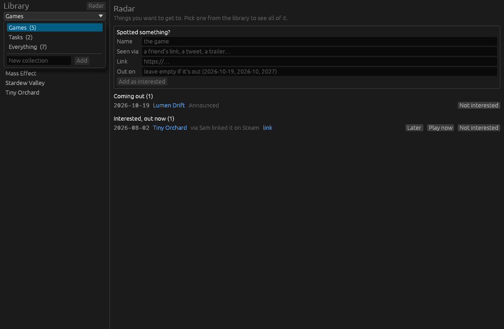
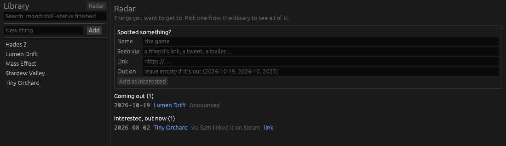
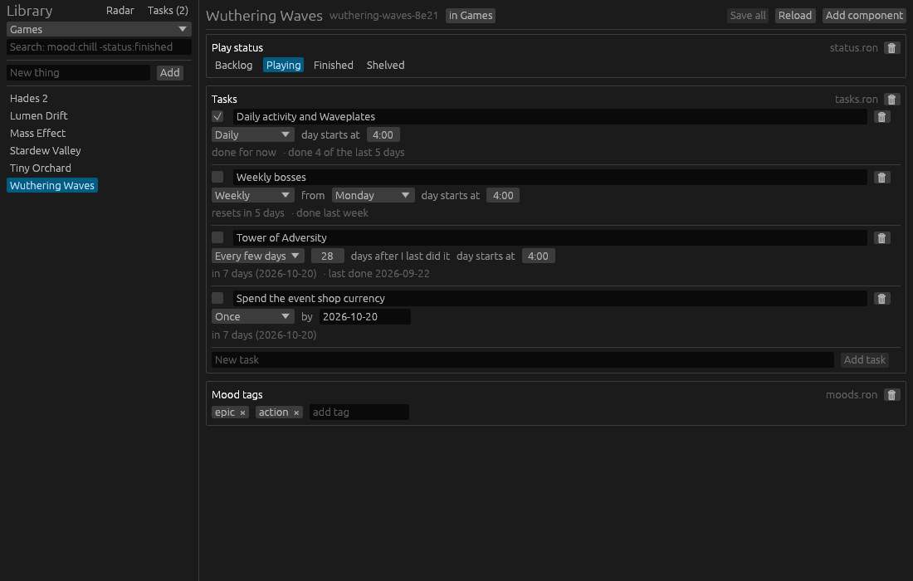
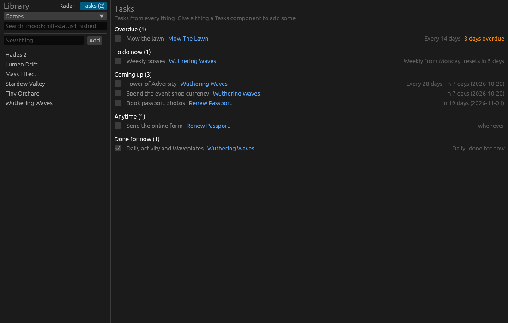
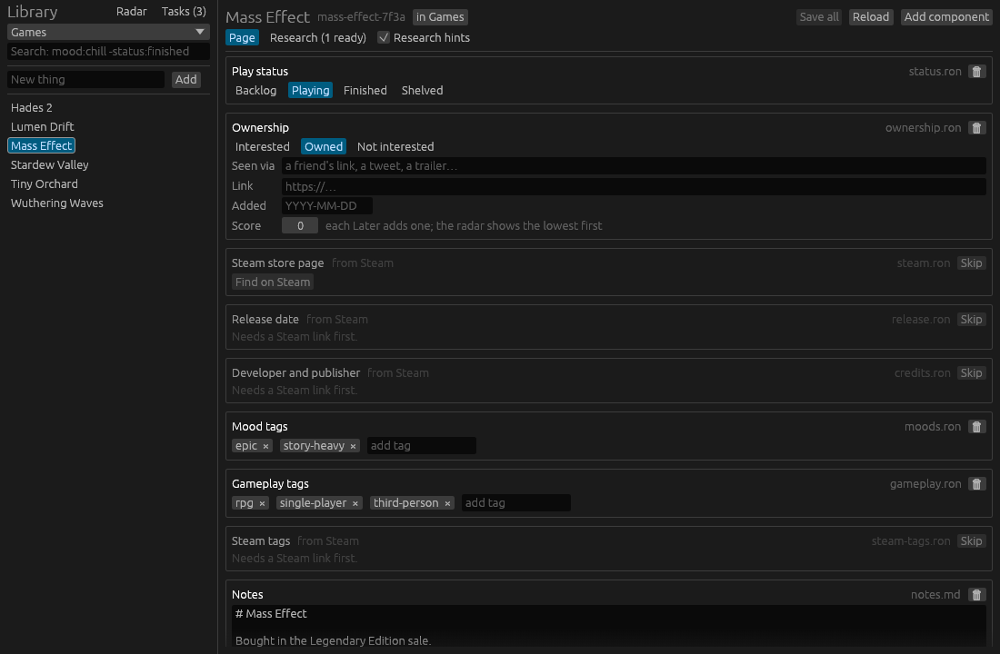

# Things

A personal desktop journal for keeping track of things, starting with games.
See [docs/pitch.md](docs/pitch.md) for the why and the design decisions.


## Run it

```sh
cargo run -- examples/data      # try it on the sample data
cargo run                       # uses $THINGS_DIR, else ~/things
```

The data folder is created if it doesn't exist. Ctrl+S (Cmd+S on macOS)
saves every changed component; switching to another entity or closing the
window saves too.

On Linux, eframe needs the usual windowing libraries at runtime
(`libxkbcommon-x11`, `libGL`/`libEGL`, and Wayland or X11).

## Collections

Things live in collections so different kinds don't mix: games in one,
tasks in another. The box at the top of the library picks the collection
to show, or **Everything**. Search, suggestions and "New thing" all work
inside the collection on screen.



A collection is a folder with a `collection.ron`:

```
Collection(
    name: "Tasks",
    starts_with: ["notes.md"],   components a new thing gets
    radar: false,                whether its things show on the radar
)
```

Add one from the bottom of the switcher, or by hand. A thing's page says
which collection it's in; click that to move it to another. IDs are unique
across collections, so moving a thing never breaks a link to it.

In **Everything**, `collection:tasks` and `-collection:games` narrow the
list, and each row says where the thing lives.

A data folder from before collections has its `entities/` folder renamed
to `games/` on first launch, with a `collection.ron` written for it. A new
data folder starts with an empty Games collection.

## Search

The box above the library takes one line of tokens:

```
mood:chill,cozy -status:finished developer:"blizzard north" noveria
```

- `key:value` keeps things with a field whose name starts with `key` and
  whose value contains `value` (`mood` finds `moods.ron`).
- `key:a,b` matches either value; `key:` alone means the thing has that field.
- Plain words search titles and everything written in the components.
- `key:>value` (also `<`, `>=`, `<=`) compares: numbers as numbers, dates
  as dates. `today` means today, so `date:>today` is everything not out yet.
- `-` in front excludes; quotes keep spaces together. Case, `-` and `_`
  don't matter.

Fields come from the files, not from code: every component is a field named
after its file, and every named field inside a RON file is one too. A
hand-written `steam.ron` with `developer: "Blizzard"` is searchable as
`developer:blizzard` right away. Hover the search box to see every key in
your library.

While you type, the box suggests keys and values that exist in your
library, most used first: `mo` offers `moods:`, `moods:` offers every mood
tag, and `glo` offers `moods:gloomy`. Tab takes the highlighted suggestion,
the arrow keys move through them (then Enter takes one), and Escape hides
them.


## Radar

With no thing open (or after pressing **Radar** above the library), the app
shows what you want to get to, from collections with `radar: true` (Games):

- **Coming out**: everything with a Release that isn't out yet, soonest
  first. Early access counts as not out; if its date passes the radar asks
  whether it's still in early access.
- **Interested, out now**: things marked Interested that you could play
  today, lowest score first, and oldest first within a score.
- **Spotted something?** takes a name, where you saw it, a link and an
  optional release date, and adds the thing as Interested in one go, to
  the first collection on the radar.

Each row works a bit like an Anki card. **Later** adds a point to its
score (stored in `ownership.ron`), so it drops below everything you haven't
put off as often. Nothing is ever hidden; the list ranks itself over time.
**Play now** marks it owned and sets play status to Playing. **Not
interested** takes it off the radar for good but keeps the record, so it
isn't added twice. The last choice can be undone from the top of the radar.



Searches get close to the same lists: `ownership:interested -release:` and
`release: -stage:released`. Play status stays about playing; ownership and
release are their own components.

## Tasks

Any thing can have a **Tasks** component (`tasks.ron`): things you should
or can do for it, such as a game's dailies, a chore or an errand. Each task
either happens once, by an optional date, or repeats:

- **Daily**, **Weekly** from a weekday, or **Monthly** from a day of the
  month. These start over on the calendar whether you did them or not.
- **Every few days**: due again so many days after you last did it, like
  mowing the lawn every 14 days.

A repeating task has a **day starts at** hour, so a game's dailies can flip
at its reset (say 4:00) instead of at midnight. Before that hour it's still
yesterday for that task.

Ticking a task records the day in the file, so the component shows how it's
gone lately ("done 4 of the last 5 days"). Unticking takes the latest day
back out.



**Tasks** above the library (with a count of what's due) shows every task
from every collection:

- **Overdue**: one-offs and every-few-days tasks past their date.
- **To do now**: dailies, weeklies and monthlies not done yet this time
  round, and anything due today. Whatever resets or falls due soonest
  comes first.
- **Coming up**: dated one-offs and every-few-days tasks not due yet.
- **Anytime**: one-offs with no date.
- **Done for now**: ticked this time round, so a misclick can be unticked.



```
Tasks(
    tasks: [
        Task(
            name: "Daily activity and Waveplates",
            repeat: Daily,          or Weekly(Mon), Monthly(15), Every(14), Once
            resets_at: 4,           the hour a new day starts; 0 if left out
            done: ["2026-10-12", "2026-10-13"],
        ),
        Task(name: "Book passport photos", repeat: Once, due: "2026-11-01"),
    ],
)
```

The Tasks collection starts new things with a task list. Task fields are
searchable like any other: `repeat:daily`, `due:<2026-11`, or `tasks:` for
everything that has some.

## Research

Things can look a game up for you. Each step needs something first (a
title, a confirmed Steam app) and fills in one component, so confirming one
finding unlocks the next: the title finds the Steam store page, and the
Steam app finds the release date, developer and publisher, and store tags.
Nothing is written until you add it.



A thing's page shows faded **research hints** where those components would
go (a per-collection setting), and the **Research** tab lists what's ready,
what's waiting and what you skipped. See [docs/research.md](docs/research.md)
for how it works and where the cache lives.

## Layout

- `crates/things-core`: entity IDs, collections, the file store, and the
  data formats of the components. No UI.
- `crates/things-app`: the egui app. `src/components/` has one module per
  component kind, each with its view and form.

## Data on disk

```
things/
  games/                     a collection
    collection.ron           Collection(name: "Games", starts_with: [...], radar: true, hints: true)
    mass-effect-7f3a/        readable slug + short ID
      status.ron             Status(state: Playing)
      steam.ron              Steam(appid: 1328670, name: "Mass Effect Legendary Edition")
      credits.ron            Credits(developers: ["BioWare"], publishers: ["Electronic Arts"])
      steam-tags.ron         Tags(tags: ["rpg", "story rich", "sci-fi"])
      ownership.ron          Interested or Owned, when added, seen via, link
      release.ron            Release(date: "2026-10-19", stage: Announced)
      moods.ron              Tags(tags: ["epic", "story-heavy"])
      tasks.ron              Tasks(tasks: [Task(name: "Dailies", repeat: Daily), ...])
      gameplay.ron           Tags(tags: ["rpg", "single-player"])
      notes.md
      journal/
        2026-10-13-1930.md   one file per entry
  tasks/
    collection.ron
    mow-the-lawn-1a2b/
      tasks.ron
      notes.md
```

Top-level folders without a `collection.ron` (such as `.git`) are ignored.

Files are the source of truth. Any file the app doesn't recognise still
shows up on the entity page as plain text, so nothing is hidden.

## Adding a component

Write a type implementing `Kind` (which files it claims, how to open and
create them) and an `Editor` (its view and form) in
`crates/things-app/src/components/`, then add it to `registry()`. If its
data format is worth testing on its own, put the type in
`things_core::components`.
