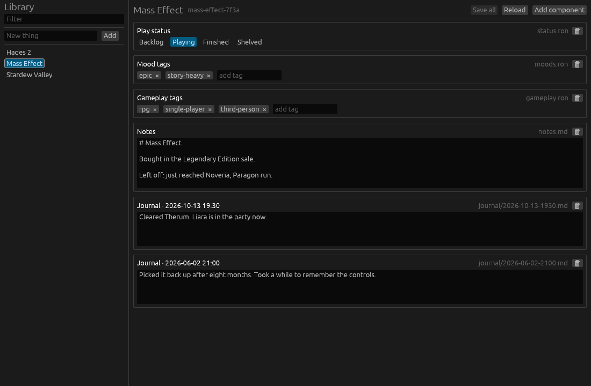
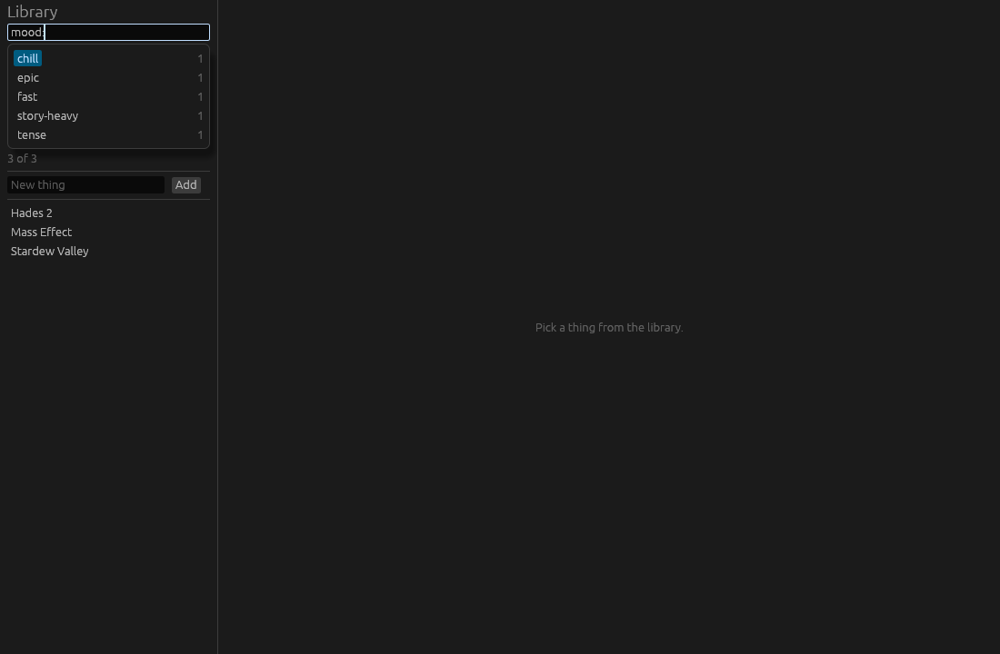

# Things

A personal desktop journal for keeping track of things, starting with games.
See [docs/pitch.md](docs/pitch.md) for the why and the design decisions.



## Run it

```sh
cargo run -- examples/data      # try it on the sample data
cargo run                       # uses $THINGS_DIR, else ~/things
```

The data folder is created if it doesn't exist. Ctrl+S (Cmd+S on macOS)
saves every changed component; switching to another entity or closing the
window saves too.

On Linux, eframe needs the usual windowing libraries at runtime
(`libxkbcommon-x11`, `libGL`/`libEGL`, and Wayland or X11).

## Search

The box above the library takes one line of tokens:

```
mood:chill,cozy -status:finished developer:"blizzard north" noveria
```

- `key:value` keeps things with a field whose name starts with `key` and
  whose value contains `value` (`mood` finds `moods.ron`).
- `key:a,b` matches either value; `key:` alone means the thing has that field.
- Plain words search titles and everything written in the components.
- `-` in front excludes; quotes keep spaces together. Case, `-` and `_`
  don't matter.

Fields come from the files, not from code: every component is a field named
after its file, and every named field inside a RON file is one too. A
hand-written `steam.ron` with `developer: "Blizzard"` is searchable as
`developer:blizzard` right away. Hover the search box to see every key in
your library.

While you type, the box suggests keys and values that exist in your
library, most used first: `mo` offers `moods:`, `moods:` offers every mood
tag, and `glo` offers `moods:gloomy`. Tab takes the highlighted suggestion,
the arrow keys move through them (then Enter takes one), and Escape hides
them.



## Layout

- `crates/things-core`: entity IDs, the file store, and the data formats of
  the components. No UI.
- `crates/things-app`: the egui app. `src/components/` has one module per
  component kind, each with its view and form.

## Data on disk

```
things/
  entities/
    mass-effect-7f3a/        readable slug + short ID
      status.ron             Status(state: Playing)
      moods.ron              Tags(tags: ["epic", "story-heavy"])
      gameplay.ron           Tags(tags: ["rpg", "single-player"])
      notes.md
      journal/
        2026-10-13-1930.md   one file per entry
```

Files are the source of truth. Any file the app doesn't recognise still
shows up on the entity page as plain text, so nothing is hidden.

## Adding a component

Write a type implementing `Kind` (which files it claims, how to open and
create them) and an `Editor` (its view and form) in
`crates/things-app/src/components/`, then add it to `registry()`. If its
data format is worth testing on its own, put the type in
`things_core::components`.
