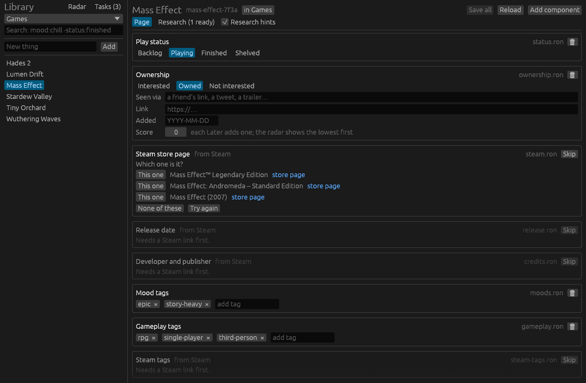
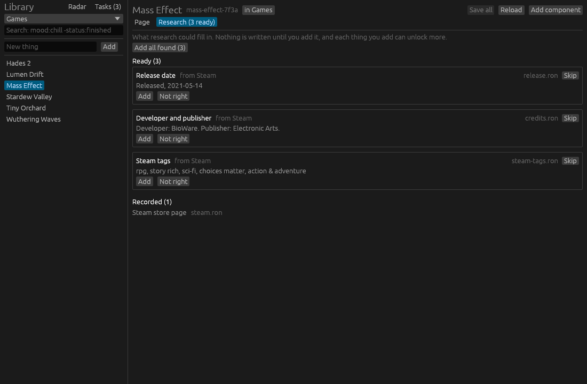

# Research

The second half of Things: the app looks things up for you, so adding a game
can be as lazy as typing its name. It never records anything on its own.
Every finding is a suggestion until you add it.

## How it works: fetch, confirm, refetch

Research is a set of **steps**. Each one needs some facts about a thing
before it can run, and fills in one component file:

| Step | Needs | Fills in | Looks at |
| --- | --- | --- | --- |
| Steam store page | a title | `steam.ron` | Steam's store search |
| Release date | a Steam link | `release.ron` | Steam's app details |
| Developer and publisher | a Steam link | `credits.ron` | Steam's app details |
| Steam tags | a Steam link | `steam-tags.ron` | the app's store page |

A step is in one of three states for a thing:

- **Recorded**: its file is already there. Research leaves it alone.
- **Ready**: everything it needs is known, so it can run.
- **Waiting**: missing something first, such as "needs a Steam link".

Confirming one step's finding is what unlocks the next. Typing "Mass Effect"
only makes "Steam store page" ready. Running it offers the matches to pick
from (it could be the Legendary Edition), and once you pick one, `steam.ron`
is written and the three Steam steps become ready. Later steps will hang off
those the same way: a Steam app ID finds the IGDB entry, and IGDB finds the
series and franchise.

Each confirmed fact is an anchor. The app never searches by name a second
time once it knows exactly which game this is.

## On a thing's page: research hints

With **Research hints** ticked, a thing's page shows a faded placeholder
for each component research could fill in, where that component would sit.
A ready one has a button to run it, and a waiting one says what it needs.
**Skip** stops it asking for this thing.

The setting belongs to the collection (`hints` in `collection.ron`), so
games can show hints while tasks don't. Untick it when you just want to
see the game as it is.

## The research view

The **Research** tab next to **Page** shows everything at once:

- **Ready**: steps that can run, each with its button, and what they found
  with **Add** and **Not right**. **Run all ready** and **Add all found**
  do the lot in one go.
- **Waiting**: steps missing something, and what.
- **Recorded**: what's already filled in.
- **Skipped**: steps you turned down for this thing, with **Ask again**.

Nothing runs until you press a button, so the app never calls a website
behind your back. Running steps automatically (say, finding the Steam page
as soon as you add a game) could come later as an option.

## What's stored where

- **Your data folder** only gets component files you added, in their normal
  formats. After that they're plain components: editable by hand,
  searchable (`developers:bioware`, `steam-tags:sci-fi`) and in Git like
  everything else.
- **The cache folder** holds the raw responses (kept for a day, so
  clicking around doesn't refetch) and which steps you skipped
  (`skipped.ron`). It's `$THINGS_CACHE` if set, else `%LOCALAPPDATA%\things`
  on Windows, `~/Library/Caches/things` on macOS and `~/.cache/things` on
  Linux. It's never inside the data folder, so it stays out of Git, and
  deleting it only means refetching (and being asked about skipped steps
  again).

## Sources

Steam needs no API key: the store search and app details are the JSON
endpoints the store itself uses, and tags are read from the store page with
its age check passed. Details use US English (`l=english&cc=US`), which
also sets the date format the release step reads ("14 May, 2021",
"Oct 2026", "Q4 2026", "Coming soon").

A step's needs, its URL and how it reads the response live in
`things-core` (`src/research.rs`, `src/research/steam.rs`) with no network
code, so they're tested against sample responses in Steam's format in
`crates/things-core/tests/fixtures/`. The fetching, caching and skip list
are in the app (`crates/things-app/src/research.rs`).

## Next

- **IGDB**, needing a Steam link and a free Twitch developer key: the IGDB
  entry, then series and franchise as links to entities in their own
  collections (`series/`, `companies/`) instead of a copy on every game.
- **Imports**: a Steam library and wishlist that create things in bulk and
  mark them owned or interested.
- Optional automatic runs for cheap steps.
